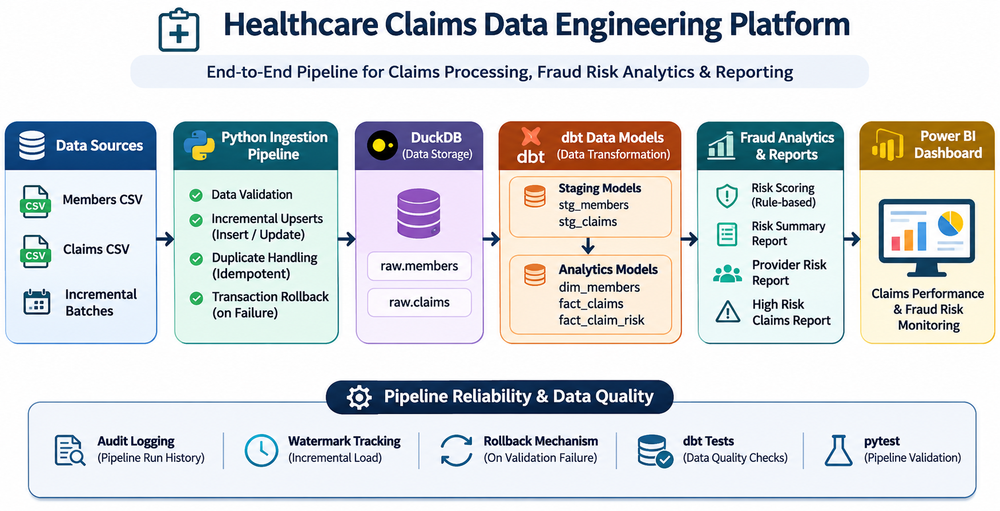
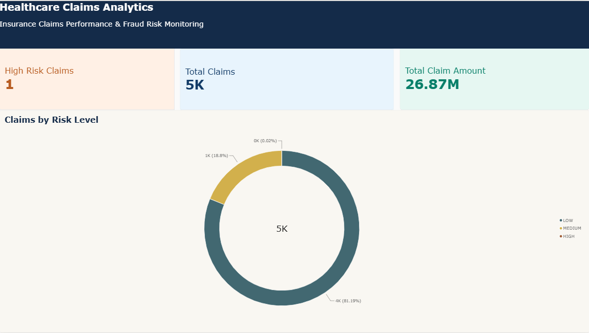

# Healthcare Claims Data Platform

### End-to-End Data Engineering & Fraud Risk Analytics Project

A portfolio project that demonstrates a healthcare insurance claims data pipeline using Python, DuckDB, dbt, SQL, automated data quality checks, incremental ingestion, audit logging, and Power BI.

All data used in this project is synthetic.

## Project Overview

This project processes synthetic healthcare insurance claims to support:

- Claims ingestion and validation
- Incremental batch processing
- Insert and update handling
- Duplicate prevention and idempotency
- Transaction rollback on validation failure
- Pipeline audit logging
- Watermark tracking
- Data transformation using dbt
- Rule-based fraud risk indicators
- Power BI analytics and reporting

## Technology Stack

| Component | Technology |
|---|---|
| Programming | Python |
| Database | DuckDB |
| Transformations | dbt, SQL |
| Data Processing | Pandas |
| Data Generation | Faker |
| Testing | dbt tests, pytest |
| Visualization | Power BI |
| Development | VS Code, Git |

## Data Architecture

The Healthcare Claims Data Engineering Platform uses Python, DuckDB, dbt, and Power BI to process synthetic healthcare claims, perform incremental ingestion, and generate fraud risk analytics.

### End-to-End Architecture

### Pipeline Reliability & Data Quality

The pipeline implements incremental watermark tracking, audit logging, idempotent upserts, transaction rollback on validation failure, automated dbt tests, and pytest validation.

## Power BI Dashboard Preview

