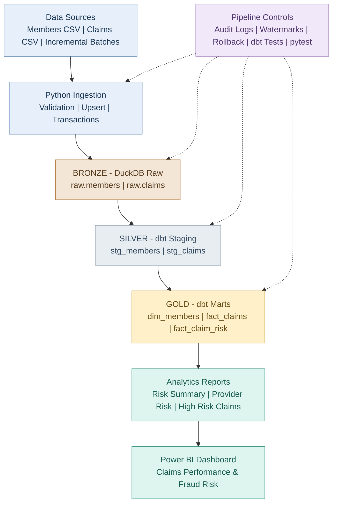

# Healthcare Claims Data Platform

### End-to-End Data Engineering & Fraud Risk Analytics Project

A portfolio project that demonstrates a healthcare insurance claims data pipeline using Python, DuckDB, dbt, SQL, automated data quality checks, incremental ingestion, audit logging, and Power BI.

All data used in this project is synthetic.

## Project Overview

This project processes synthetic healthcare insurance claims to support:

- Claims ingestion and validation
- Incremental batch processing
- Insert and update handling
- Duplicate prevention and idempotency
- Transaction rollback on validation failure
- Pipeline audit logging
- Watermark tracking
- Data transformation using dbt
- Rule-based fraud risk indicators
- Power BI analytics and reporting

## Technology Stack

| Component | Technology |
|---|---|
| Programming | Python |
| Database | DuckDB |
| Transformations | dbt, SQL |
| Data Processing | Pandas |
| Data Generation | Faker |
| Testing | dbt tests, pytest |
| Visualization | Power BI |
| Development | VS Code, Git |

## Data Architecture
### Architecture Diagram


[View Healthcare Claims Architecture Diagram](docs/architecture.md)
```text
Synthetic Claims & Members
            |
            v
      CSV Data Files
            |
            v
   Python Ingestion Pipeline
            |
            v
       DuckDB Raw Layer
            |
            v
       dbt Staging Models
            |
            v
    Dimensional Data Marts
     /               \
dim_members       fact_claims
                       |
                       v
                fact_claim_risk
                       |
                       v
                 Power BI
```

## Incremental Pipeline

The pipeline supports new claim inserts and updates to existing claims.

Key features:

- Batch validation before processing
- Atomic database transactions
- Duplicate batch prevention
- Audit records for successful batches
- Watermark tracking
- Rollback when validation fails

## Data Quality

Data quality checks cover:

- Unique claim and member identifiers
- Required fields
- Valid claim amounts
- Accepted claim statuses
- Member relationships
- Duplicate detection

## Fraud Risk Analytics

Claims are assigned rule-based risk indicators using:

1. High claim amounts
2. Multiple same-day claims
3. Potential duplicate billing patterns

These indicators are intended for analytical review and do not establish actual fraud.

## Power BI Dashboard

The dashboard includes:

- Total Claims
- Total Claim Amount
- High Risk Claims
- Claims by Risk Level

## Project Results

- Successfully processed more than 5,000 synthetic claims
- Demonstrated incremental ingestion
- Verified audit and watermark tracking
- Tested transaction rollback
- Passed nine dbt data quality tests
- Created an interactive Power BI dashboard

## Future Improvements

- Pipeline orchestration
- Automated CI/CD
- More advanced risk analytics
- Additional Power BI visualizations

## Disclaimer

This project uses entirely synthetic data for educational and portfolio purposes. It does not contain real patient information.
## Power BI Dashboard Preview

